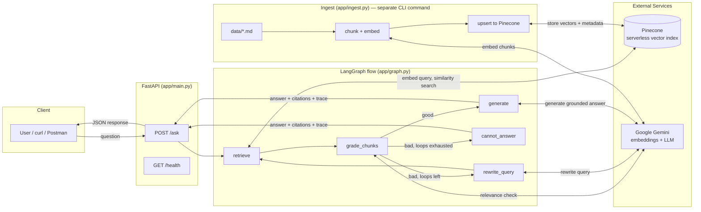

# Agentic-rag-fastapi — Document Q&A API

A small HTTP API that answers questions **only from an ingested document corpus**, using LangGraph to orchestrate retrieval, relevance grading, and grounded generation, with Pinecone as the vector store. If the documents don't contain the answer, the API says so explicitly instead of guessing.

**Author:** Piyush Ratn
**Assignment:** Legixo Thinklabs — Gen AI Intern Take-home

---

## Quick summary

| Requirement | Status |
|---|---|
| Python 3.10+ | ✅ Python 3.12 |
| LangGraph (`StateGraph`, real branch, loop limit) | ✅ 5-node graph, conditional branch, dual loop guard |
| Pinecone (real cloud vector DB) | ✅ Serverless index, auto-created on ingest |
| HTTP API for Q&A (`POST /ask`) | ✅ FastAPI, JSON in/out, no CLI required for asking |
| Ingest documented, idempotent | ✅ `python -m app.ingest`, deterministic chunk IDs |
| README, `.env.example`, LangGraph docs | ✅ this file + `docs/langgraph.md` |
| Self-test file (10–15 questions) | ✅ `eval/self_test.json`, all manually run and annotated |

---

## Tech stack

- **Python 3.12**
- **FastAPI** — HTTP API (`POST /ask`, `GET /health`)
- **LangGraph** (`StateGraph`) — orchestrates retrieve → grade (branch) → generate / rewrite-retry / cannot-answer, with a loop cap
- **Pinecone** (serverless, real cloud index) — vector store, via the official `pinecone` Python client
- **Google Gemini** — `gemini-embedding-001` for embeddings (768-dim, scaled down from the native 3072 via Matryoshka Representation Learning), `gemini-flash-lite-latest` for grading, query rewriting, and answer generation

See [`docs/langgraph.md`](docs/langgraph.md) for the full graph diagram and a node-by-node walkthrough.

---

## System design



**Flow in plain words:**
1. **Ingest (offline, one-time or repeatable):** the 6 source documents are chunked, embedded with Gemini, and upserted into Pinecone with metadata (`source_file`, `chunk_id`, `chunk_index`) so answers can always be traced back to their source.
2. **Ask (per request):** FastAPI receives a question → LangGraph embeds it and searches Pinecone → an LLM grades whether the retrieved chunks are actually sufficient → if yes, a grounded answer with inline citations is generated; if no, the query is rewritten and retried (up to a hard cap), after which the system honestly reports it can't find an answer rather than guessing.

---

## Project structure

```
legixo-genai-takehome/
├── app/
│   ├── __init__.py
│   ├── config.py            # all env-var configuration in one place
│   ├── chunking.py          # character-based text splitter
│   ├── embeddings.py        # Gemini embeddings wrapper
│   ├── pinecone_client.py   # Pinecone index bootstrap (auto-creates index)
│   ├── ingest.py            # CLI: chunk + embed + upsert corpus into Pinecone
│   ├── graph.py             # ★ the LangGraph flow — the core deliverable
│   ├── schemas.py           # Pydantic request/response models
│   └── main.py              # FastAPI app (POST /ask, GET /health)
├── data/                    # sample corpus — 6 fictional legal-style notes
│   ├── 01_matter_memo_arvind_v_northfield.md
│   ├── 02_employment_agreement_excerpt.md
│   ├── 03_hearing_notice_template.md
│   ├── 04_statute_style_excerpt_fictional.md
│   ├── 05_counsel_notes_settlement.md
│   └── 06_property_lease_clause.md
├── docs/
│   └── langgraph.md         # graph diagram + node-by-node explanation
├── eval/
│   └── self_test.json       # 15 self-test questions, manually run, pass/fail notes filled in
├── requirements.txt
├── .env.example
├── .gitignore
└── README.md
```

---

## 1. Setup

```powershell
git clone <your-repo-url>
cd legixo-genai-takehome
py -3.12 -m venv .venv
.venv\Scripts\activate
pip install -r requirements.txt
Copy-Item .env.example .env
```

(Mac/Linux/WSL equivalent: `python3.12 -m venv .venv && source .venv/bin/activate`)

Edit `.env` and fill in real values:

| Variable | Required | Notes |
|---|---|---|
| `GEMINI_API_KEY` | yes | from Google AI Studio → aistudio.google.com/apikey |
| `EMBEDDING_MODEL` | no (default set) | `gemini-embedding-001` |
| `EMBEDDING_DIM` | no | `768` — scaled down from Gemini's native 3072-dim output; must match the Pinecone index dimension |
| `LLM_MODEL` | no | `gemini-flash-lite-latest` — an alias that tracks Google's current lightweight model rather than a version pin (see "Known quirks" below for why) |
| `PINECONE_API_KEY` | yes | from your Pinecone project console |
| `PINECONE_INDEX_NAME` | no | index is auto-created on first ingest if it doesn't exist |
| `PINECONE_CLOUD` / `PINECONE_REGION` | no | serverless spec, defaults `aws` / `us-east-1` |
| `PINECONE_NAMESPACE` | no | default `docs` |
| `CHUNK_SIZE` / `CHUNK_OVERLAP` | no | characters (not tokens), kept simple on purpose for this corpus size |
| `TOP_K` | no | chunks retrieved per query |
| `SCORE_THRESHOLD` | no | cosine similarity floor for the cheap first-pass grading check |
| `MAX_GRAPH_LOOPS` | no | max query-rewrite retries before the graph gives up and returns "cannot answer" |

**`.env` is never committed** — only `.env.example` (dummy placeholder values) is tracked in git.

---

## 2. Pinecone checklist

- **Creating the index:** no manual step needed. `app/ingest.py` calls `ensure_index()`, which creates a **real serverless Pinecone index** with the correct dimension automatically if `PINECONE_INDEX_NAME` doesn't already exist.
- **Env vars needed:** `PINECONE_API_KEY`, `PINECONE_INDEX_NAME`, `PINECONE_CLOUD`, `PINECONE_REGION`, `PINECONE_NAMESPACE`.
- **What happens if ingest is run twice:** it's safe and idempotent. Each chunk's Pinecone vector ID is a **deterministic SHA1 hash** of `source_file + chunk_index`. Re-running `python -m app.ingest` re-upserts the same IDs (Pinecone upsert = insert-or-overwrite), so nothing is duplicated. If chunking parameters change such that a file now produces fewer chunks than before, run `python -m app.ingest --reset` to wipe the namespace first and avoid orphaned stale vectors.

---

## 3. Ingest the corpus

```powershell
python -m app.ingest            # normal run — safe to repeat any number of times
python -m app.ingest --reset    # wipes the namespace first, then re-ingests everything fresh
```

Expected output:
```
  01_matter_memo_arvind_v_northfield.md: 1 chunks
  02_employment_agreement_excerpt.md: 1 chunks
  03_hearing_notice_template.md: 1 chunks
  04_statute_style_excerpt_fictional.md: 1 chunks
  05_counsel_notes_settlement.md: 1 chunks
  06_property_lease_clause.md: 1 chunks
Ingest complete: 6 chunks from 6 files upserted into namespace 'docs'.
```

---

## 4. Start the API

```powershell
uvicorn app.main:app --reload --port 8000
```

Health check:
```powershell
Invoke-RestMethod -Uri "http://localhost:8000/health"
```
Expected: `{"status":"ok"}`

---

## 5. Ask a question

**PowerShell (Windows)** — note that PowerShell's built-in `curl` alias is not real curl and doesn't accept `-X`/`-H`/`-d` flags the same way, so use `Invoke-RestMethod` instead:

```powershell
$body = @{ question = "What is the notice period in Priya Nambiar's employment agreement?" } | ConvertTo-Json
Invoke-RestMethod -Uri "http://localhost:8000/ask" -Method Post -ContentType "application/json" -Body $body | ConvertTo-Json -Depth 10
```

**curl (Mac/Linux/WSL):**
```bash
curl -X POST http://localhost:8000/ask \
  -H "Content-Type: application/json" \
  -d '{"question": "What is the notice period in Priya Nambiar'\''s employment agreement?"}'
```

**Example response:**
```json
{
  "answer": "Either Priya Nambiar or Bluecrest must give 60 days of written notice to end the employment agreement [02_employment_agreement_excerpt.md#0].",
  "citations": [
    {
      "source_file": "02_employment_agreement_excerpt.md",
      "chunk_id": "20e085c6197d7d651b3da729902244fa27500ee9",
      "chunk_index": 0,
      "text_snippet": "Either party may end this agreement by giving 60 days written notice...",
      "score": 0.79
    }
  ],
  "trace": {
    "steps": [
      "retrieve: query='...' -> 5 chunks (top score=0.792)",
      "grade: good (LLM relevance check)",
      "generate: answer produced from retrieved context"
    ]
  }
}
```

**Out-of-corpus question** — shows the "cannot answer" path:
```powershell
$body = @{ question = "What is the current GST rate on legal services in India?" } | ConvertTo-Json
Invoke-RestMethod -Uri "http://localhost:8000/ask" -Method Post -ContentType "application/json" -Body $body | ConvertTo-Json -Depth 10
```
Response shows `citations: []` and a `trace.steps` array demonstrating the full retry loop before giving up:
```json
"trace": { "steps": [
  "retrieve: ... -> 5 chunks (top score=0.533)",
  "grade: bad (LLM relevance check)",
  "rewrite_query (attempt 1): 'GST rate legal services India current'",
  "retrieve: ... -> 5 chunks (top score=0.544)",
  "grade: bad (LLM relevance check)",
  "rewrite_query (attempt 2): 'GST rate legal services India'",
  "retrieve: ... -> 5 chunks (top score=0.541)",
  "grade: bad (LLM relevance check)",
  "cannot_answer: retrieval loops exhausted without sufficient context"
]}
```

---

## 6. Self-test / eval

`eval/self_test.json` contains 15 questions — one covering each notable fact across all 6 source documents, plus 2 deliberately out-of-corpus questions to verify the "I don't know" path. Every question was run manually against the live API, checked against expected source file(s) and expected facts, and annotated with a PASS/FAIL note directly in the file.

---

## What I skipped / would improve with more time

- **No reranker or hybrid (BM25 + vector) search** — pure dense retrieval only. For a 6-document corpus this doesn't matter much, but would be necessary at scale.
- **Chunking is a plain character splitter**, not heading/section-aware. Fine for these short notes; would need improvement for longer, more structurally complex documents.
- **`citations` in the API response currently returns all retrieved chunks**, not only the ones actually inline-cited (`[source_file#chunk_index]`) in the generated answer text. All returned chunks are genuinely retrieved (never fabricated), but the array isn't filtered down to exactly what the answer references. A quick follow-up would be to regex-parse the citation tags out of the answer and filter the `citations` list to just those.
- **No LangSmith tracing wired up** — `trace.steps` in the API response is a manual, lightweight substitute that still gives full visibility into which path the graph took on any given request.
- **No auth or rate limiting** on the API — out of scope for a take-home, but would add API-key auth and per-key rate limits before any real deployment.
- **No automated CI** running the eval set on every push.

---

## Known quirks encountered while building this, and how they were resolved

Documenting these because they were genuine, current environment/API issues as of August 2026 — not code bugs — and debugging them was a real part of this project:

1. **Python 3.14 (Windows Store default) couldn't build `pydantic-core`.** No pre-built wheel existed yet for that Python version, and compiling from source needed a Rust toolchain plus an MSVC linker that wasn't installed. **Fix:** installed Python 3.12 alongside it and recreated the virtual environment with `py -3.12 -m venv .venv` — 3.12 has stable pre-built wheels for every dependency.

2. **Google was mid-migration on Gemini API key formats** (`AIza...` "Standard" keys → new `AQ.Ab...` "Auth" keys, rolled out June–September 2026). Initial SDK versions didn't handle the new key format correctly, returning `401 UNAUTHENTICATED` / `ACCESS_TOKEN_TYPE_UNSUPPORTED` even with a valid key. **Fix:** upgraded `google-genai` from `0.7.0` to `2.17.0`, which resolved the incompatibility.

3. **`text-embedding-004` was deprecated** (January 14, 2026) in favor of `gemini-embedding-001`, which also changed the default output dimension from 768 to 3072. **Fix:** switched the model name and passed `output_dimensionality=768` via `EmbedContentConfig` to keep the smaller, cheaper vector size for this corpus.

4. **`gemini-2.0-flash` returned a `0` free-tier quota** on this account despite being listed as available. **Fix:** switched to `gemini-flash-lite-latest` — a rolling alias that tracks whichever lightweight model Google currently supports, rather than a version string that can silently go stale.

5. **LangGraph raised `ValueError: 'grade' is already being used as a state key`.** A node registered as `"grade"` collided with a `GraphState` TypedDict field also named `grade`. **Fix:** renamed the node to `grade_chunks` in `add_node`/`add_edge`/`add_conditional_edges`; the state field itself stays `grade`.

6. **`.env` values weren't loading correctly** despite the file content looking right in a text editor — traced to a stale save that hadn't actually persisted from an earlier edit. Confirmed via raw byte inspection (`open('.env', 'rb')`) and checking `load_dotenv()`'s boolean return value directly, rather than trusting the editor's displayed content.

Each of these was verified against Google's own developer forums / changelog before being treated as an external issue rather than a bug in this code.

---

## Demo video

[[(https://drive.google.com/file/d/1Fxth8P7SUPv2NYeEcrqCDv5rWinoIuwW/view?usp=drive_link)]: install → ingest → start API → `/ask` calls with real citations → one out-of-corpus question → walkthrough of `app/graph.py` and `docs/langgraph.md`]
