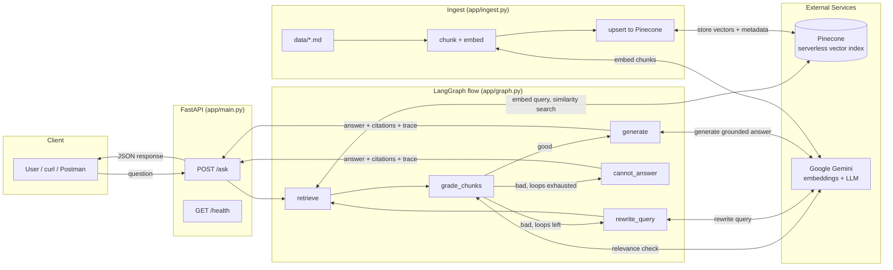

# Agentic RAG FastAPI — Grounded Document Q&A

A small HTTP API that answers questions **only from an ingested document corpus**. LangGraph orchestrates retrieval, relevance grading, and grounded generation, with Pinecone as the vector store. If the documents don't contain the answer, the API says so explicitly instead of guessing.

**Author:** Piyush Ratn · **Demo:** [Watch the walkthrough](https://drive.google.com/file/d/1Fxth8P7SUPv2NYeEcrqCDv5rWinoIuwW/view?usp=drive_link)

---

## Highlights

- **Grounded or silent.** Every answer carries inline citations (`[source_file#chunk_index]`). If retrieval can't support an answer, the graph returns an explicit "cannot answer" instead of hallucinating.
- **Real branching, bounded loops.** A LangGraph `StateGraph` grades retrieved chunks, then either generates, rewrites the query and retries, or gives up. A hard cap (`MAX_GRAPH_LOOPS`) prevents runaway loops.
- **Observable.** Every response includes `trace.steps`, a step-by-step record of the path the graph took for that request.
- **Idempotent ingest.** Deterministic chunk IDs mean re-running ingest never creates duplicates.
- **Real cloud vector DB.** Pinecone serverless index, auto-created on first ingest.

---

## Quick start

```bash
git clone <your-repo-url>
cd Agentic-rag-fastapi
python3.12 -m venv .venv && source .venv/bin/activate
pip install -r requirements.txt
cp .env.example .env            # then fill in GEMINI_API_KEY and PINECONE_API_KEY
python -m app.ingest            # chunk, embed, upsert the corpus
uvicorn app.main:app --port 8000
```

**Windows (PowerShell):**

```powershell
py -3.12 -m venv .venv
.venv\Scripts\activate
pip install -r requirements.txt
Copy-Item .env.example .env
python -m app.ingest
uvicorn app.main:app --port 8000
```

Ask a question:

```bash
curl -X POST http://localhost:8000/ask \
  -H "Content-Type: application/json" \
  -d '{"question": "What is the notice period in Priya Nambiar'\''s employment agreement?"}'
```

> **Python version:** use **3.12**. Python 3.14 currently lacks pre-built wheels for `pydantic-core`, so installs fail unless you have a Rust toolchain and MSVC build tools.

---

## Tech stack

| Layer | Choice |
|---|---|
| Language | Python 3.12 |
| API | FastAPI (`POST /ask`, `GET /health`) |
| Orchestration | LangGraph `StateGraph` |
| Vector store | Pinecone serverless (official `pinecone` client) |
| Embeddings | Google `gemini-embedding-001`, 768-dim via Matryoshka output scaling (native is 3072) |
| LLM | `gemini-flash-lite-latest` for grading, query rewriting, and generation |

Full graph diagram and node walkthrough: [`docs/langgraph.md`](docs/langgraph.md).

---

## Architecture



**Ingest (offline, repeatable).** Source documents are chunked, embedded with Gemini, and upserted into Pinecone with metadata (`source_file`, `chunk_id`, `chunk_index`) so every answer can be traced to its source.

**Ask (per request).** FastAPI receives a question. LangGraph embeds it and searches Pinecone. An LLM grades whether the retrieved chunks are sufficient. If yes, a grounded answer with inline citations is generated. If no, the query is rewritten and retried up to a hard cap, after which the system reports it can't answer.

**Worst-case cost.** For an unanswerable question with `MAX_GRAPH_LOOPS=2`: 3 retrievals, 3 grading calls, and 2 rewrite calls (about 5 LLM calls, no generation call).

---

## Project structure

```
Agentic-rag-fastapi/
├── app/
│   ├── config.py            # all env-var configuration in one place
│   ├── chunking.py          # character-based text splitter
│   ├── embeddings.py        # Gemini embeddings wrapper
│   ├── pinecone_client.py   # Pinecone index bootstrap (auto-creates index)
│   ├── ingest.py            # CLI: chunk + embed + upsert corpus
│   ├── graph.py             # the LangGraph flow (core of the project)
│   ├── schemas.py           # Pydantic request/response models
│   └── main.py              # FastAPI app
├── data/                    # sample corpus: 6 fictional legal-style notes
├── docs/
│   └── langgraph.md         # graph diagram + node-by-node explanation
├── eval/
│   └── self_test.json       # 15 questions with expected sources and facts
├── requirements.txt
├── .env.example
└── README.md
```

---

## Configuration

Copy `.env.example` to `.env`. **`.env` is never committed.**

| Variable | Required | Default | Notes |
|---|---|---|---|
| `GEMINI_API_KEY` | yes | — | Google AI Studio → aistudio.google.com/apikey |
| `PINECONE_API_KEY` | yes | — | Pinecone project console |
| `EMBEDDING_MODEL` | no | `gemini-embedding-001` | |
| `EMBEDDING_DIM` | no | `768` | Must match the Pinecone index dimension |
| `LLM_MODEL` | no | `gemini-flash-lite-latest` | Rolling alias, so it won't silently go stale like a pinned version string |
| `PINECONE_INDEX_NAME` | no | *(see `.env.example`)* | Auto-created on first ingest if missing |
| `PINECONE_CLOUD` / `PINECONE_REGION` | no | `aws` / `us-east-1` | Serverless spec |
| `PINECONE_NAMESPACE` | no | `docs` | |
| `CHUNK_SIZE` / `CHUNK_OVERLAP` | no | *(see `.env.example`)* | Characters, not tokens |
| `TOP_K` | no | *(see `.env.example`)* | Chunks retrieved per query |
| `SCORE_THRESHOLD` | no | *(see `.env.example`)* | Cosine similarity floor |
| `MAX_GRAPH_LOOPS` | no | *(see `.env.example`)* | Max rewrite-and-retry cycles before "cannot answer" |

---

## Ingest

```bash
python -m app.ingest            # safe to repeat any number of times
python -m app.ingest --reset    # wipe the namespace first, then re-ingest
```

Expected output:

```
  01_matter_memo_arvind_v_northfield.md: 1 chunks
  02_employment_agreement_excerpt.md: 1 chunks
  03_hearing_notice_template.md: 1 chunks
  04_statute_style_excerpt_fictional.md: 1 chunks
  05_counsel_notes_settlement.md: 1 chunks
  06_property_lease_clause.md: 1 chunks
Ingest complete: 6 chunks from 6 files upserted into namespace 'docs'.
```

**Idempotency.** Each vector ID is a deterministic SHA1 hash of `source_file + chunk_index`. Re-running ingest overwrites the same IDs (Pinecone upsert is insert-or-overwrite), so nothing is duplicated. If a change to chunking parameters means a file now produces *fewer* chunks than before, run with `--reset` to avoid orphaned stale vectors.

**Index creation.** No manual step. `ensure_index()` creates a serverless index with the correct dimension if it doesn't exist.

---

## API reference

### `GET /health`

Returns `{"status": "ok"}`.

### `POST /ask`

**Request**

```json
{ "question": "What is the notice period in Priya Nambiar's employment agreement?" }
```

**Response**

| Field | Type | Description |
|---|---|---|
| `answer` | string | Grounded answer with inline `[source_file#chunk_index]` citations, or an explicit "cannot answer" message |
| `citations` | array | Retrieved chunks backing the answer: `source_file`, `chunk_id`, `chunk_index`, `text_snippet`, `score`. Empty when the graph couldn't answer |
| `trace.steps` | array of strings | Ordered record of every graph node executed for this request |

**Answerable question**

```json
{
  "answer": "Either Priya Nambiar or Bluecrest must give 60 days of written notice to end the employment agreement [02_employment_agreement_excerpt.md#0].",
  "citations": [
    {
      "source_file": "02_employment_agreement_excerpt.md",
      "chunk_id": "20e085c6197d7d651b3da729902244fa27500ee9",
      "chunk_index": 0,
      "text_snippet": "Either party may end this agreement by giving 60 days written notice...",
      "score": 0.79
    }
  ],
  "trace": {
    "steps": [
      "retrieve: query='...' -> 5 chunks (top score=0.792)",
      "grade: good (LLM relevance check)",
      "generate: answer produced from retrieved context"
    ]
  }
}
```

**Out-of-corpus question** (the "cannot answer" path, showing the full retry loop)

Request: `{"question": "What is the current GST rate on legal services in India?"}`

```json
{
  "answer": "I could not find this information in the provided documents.",
  "citations": [],
  "trace": {
    "steps": [
      "retrieve: ... -> 5 chunks (top score=0.533)",
      "grade: bad (LLM relevance check)",
      "rewrite_query (attempt 1): 'GST rate legal services India current'",
      "retrieve: ... -> 5 chunks (top score=0.544)",
      "grade: bad (LLM relevance check)",
      "rewrite_query (attempt 2): 'GST rate legal services India'",
      "retrieve: ... -> 5 chunks (top score=0.541)",
      "grade: bad (LLM relevance check)",
      "cannot_answer: retrieval loops exhausted without sufficient context"
    ]
  }
}
```

Note how the top similarity score (~0.54) is non-trivial even for an unrelated question. This is why grading relies on an LLM relevance check rather than a score threshold alone.

---

## Evaluation

`eval/self_test.json` holds 15 questions: at least one per source document, plus 2 deliberately out-of-corpus questions to verify the "cannot answer" path. Each entry records the expected source file(s) and expected facts. All 15 were run manually against the live API and annotated with PASS/FAIL notes in the file.

---

## Limitations and next steps

Deliberately out of scope for this take-home, in rough priority order:

1. **Citation filtering.** `citations` returns all retrieved chunks, not only those referenced inline in the answer. Every returned chunk was genuinely retrieved (never fabricated), but the fix is small: regex the `[file#idx]` tags out of the answer and filter the list.
2. **Automated eval.** The self-test is annotated by hand. A runner that calls `/ask` and asserts expected sources would make it reproducible and CI-friendly.
3. **Retrieval at scale.** Each of the 6 documents fits in one chunk, so chunking, overlap, and top-k are barely exercised. Real corpora need heading-aware chunking, a reranker, and hybrid (BM25 + dense) search.
4. **Observability.** `trace.steps` is a lightweight substitute for LangSmith tracing.
5. **Hardening.** No auth, rate limiting, or retry/backoff on Gemini 429s and Pinecone errors; those need adding before real deployment.
6. **Packaging.** No Dockerfile or CI pipeline yet.

---

## Troubleshooting

| Symptom | Cause | Fix |
|---|---|---|
| `pydantic-core` fails to build on install | Python 3.14 has no pre-built wheel | Use Python 3.12 |
| `401 UNAUTHENTICATED` / `ACCESS_TOKEN_TYPE_UNSUPPORTED` with a valid Gemini key | Older `google-genai` SDK doesn't handle Google's newer `AQ.Ab...` key format | Upgrade `google-genai` (verified working on `2.17.0`) |
| Embedding dimension mismatch | `gemini-embedding-001` defaults to 3072 dims | Set `EMBEDDING_DIM=768` and make sure the index matches |
| `404` / "model not found" on `text-embedding-004` | Deprecated January 2026 | Use `gemini-embedding-001` |
| `429` / zero quota on a specific Gemini model | Free-tier quota varies per model and account | Switch `LLM_MODEL` (default alias is `gemini-flash-lite-latest`) |
| `.env` values not loading | File not actually saved, or wrong working directory | Run `python -c "from dotenv import load_dotenv; print(load_dotenv())"` and confirm it prints `True` |
| Stale results after changing chunk size | Orphaned vectors from the old chunking | `python -m app.ingest --reset` |

---

## Design notes

- **LangGraph state key vs node name.** LangGraph forbids a node name that collides with a state key. The node is named `grade_chunks`, while the state field is `grade`.
- **Why an LLM grader, not just a score threshold.** Cosine scores for unrelated questions sit close to scores for weak matches (see the trace above), so a threshold alone can't separate them reliably. The grader makes the final call.
- **Why a rolling LLM alias.** `gemini-flash-lite-latest` tracks Google's current lightweight model instead of pinning a version string that can be retired.
